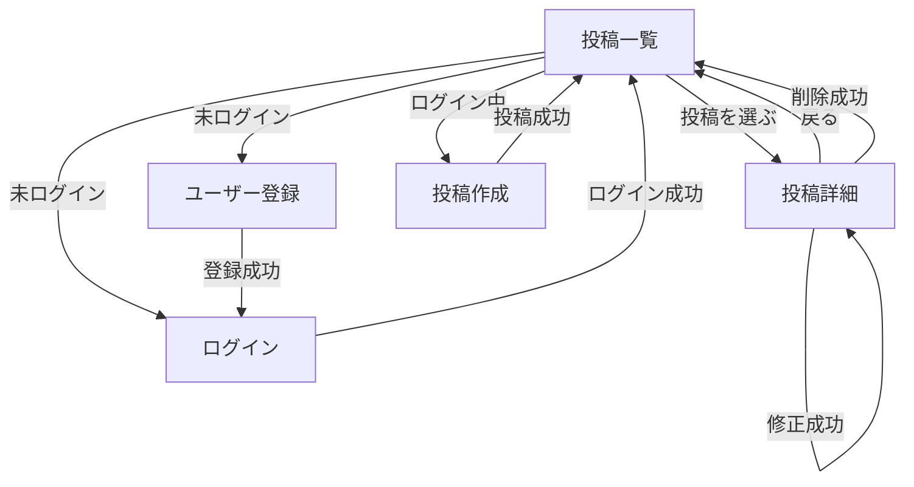

# 画面設計

利用者が見る画面と、画面から画面への移動です。URL と HTTP メソッドは [routing-design.md](routing-design.md) に書きます。機能の範囲は [requirements.md](requirements.md) に従います。

画面は 5 つです。キャプションの修正と削除は投稿詳細に置き、別画面は作りません。いいねとコメントの画面は作りません。

## 画面一覧

| 画面 | 役割 | ログイン |
|---|---|---|
| 投稿一覧 | トップ。みんなの投稿を新しい順に並べる | 不要 |
| 投稿詳細 | 投稿 1 件を大きく見る。自分の投稿なら修正と削除ができる | 閲覧は不要。修正と削除は必要 |
| ユーザー登録 | ユーザー名とパスワードを登録する | 不要 |
| ログイン | ユーザー名とパスワードでログインする | 不要 |
| 投稿作成 | 写真 1 枚とキャプションを投稿する | 必要 |

## 共通のヘッダー

どの画面にも、状態に応じたリンクを出します。

- 未ログイン: 「ログイン」「ユーザー登録」。投稿一覧へ戻れる。
- ログイン中: 「投稿作成」「ログアウト」。投稿一覧へ戻れる。ログイン中のユーザー名も出す。

未ログインの人には「投稿作成」を出さない。ログイン中の人には「ログイン」「ユーザー登録」を出さない。

## 投稿一覧

ログインしていなくても見られます。

各投稿に出すもの:

- ユーザー名
- 写真
- キャプション
- 投稿日時

並び順は新しい投稿が先です。投稿を選ぶとその投稿詳細へ進みます。投稿が 1 件もないときは、まだ投稿がない旨を出します。

## 投稿詳細

ログインしていなくても見られます。一覧と同じ項目を、1 件だけ大きく出します。

- ユーザー名
- 写真
- キャプション
- 投稿日時
- 投稿一覧へ戻るリンク

ログイン中で、その投稿の投稿者であるときだけ、次も出します。

- キャプションの修正フォーム。写真の選び直しは出さない。
- 削除ボタン。

投稿者が違うとき、未ログインのときは、修正フォームと削除ボタンを出さない。存在しない投稿は、この画面の中身を出さず、見つからない旨と一覧へ戻るリンクを出します。

## ユーザー登録

入力項目はユーザー名、メールアドレス、パスワードです。メールアドレスは一覧や詳細には出しません。ログインには使いません。

- 成功したらログイン画面へ移る。
- ユーザー名が空、使えない文字、既に使われている、メールアドレスが空、形式が違う、既に使われている、パスワードが8文字未満のときは、この画面に残り、理由を出す。入力していたユーザー名とメールアドレスは残してよい。パスワードは残さない。

## ログイン

入力項目はユーザー名とパスワードです。ユーザー登録へのリンクも出します。

- 成功したら投稿一覧へ移る。投稿作成の途中でここに来た場合も、成功後は投稿一覧です。
- ユーザー名またはパスワードが違うときは、この画面に残り、理由を出す。

## 投稿作成

ログイン中だけ開けます。未ログインで開いた場合は、フォームを出さずログイン画面へ移します。

入力項目:

- 写真 1 枚。PNG、JPEG、GIF のどれか。5MB まで。必須。
- キャプション。空でもよい。200 文字まで。

成功したら投稿一覧へ移ります。写真がない、形式が違う、大きすぎる、キャプションが長すぎるときは、この画面に残り、理由を出します。

## 画面遷移

ログアウトはどの画面からでもでき、未ログインの投稿一覧へ移ります。
